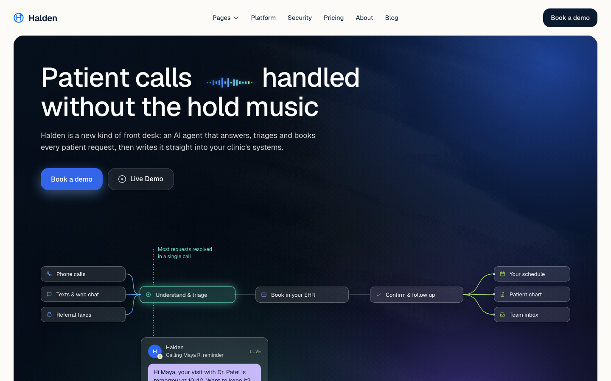

# Halden – AI Healthcare SaaS Astro Theme

A free, open-source Astro theme for healthcare, health-tech and AI SaaS websites. Clean, calm design with a dark hero, product mockups built in HTML, smooth scroll animations, an MDX blog and legal pages. Fast, accessible and easy to rebrand.



**Live demo:** https://halden-astro-theme.vercel.app

## Quick start

```bash
npm create astro@latest -- --template WavespaceAgency/halden-astro-theme
cd <your-project>
npm install
npm run dev
```

Open http://localhost:4321.

## Features

- **11 pages:** Home, Platform, Security, Pricing, About, Blog, Blog post, Book a demo, Privacy Policy, Terms of Service, 404
- **Pixel-perfect** build of the Halden Figma design, fully responsive from 320px to 1920px
- **Full-width, interactive design:** full-width header that hides on scroll, animated hero with a live flow diagram, hover effects on every card and button
- **Smooth animations:** eased smooth scrolling, text effects, scroll reveals, count-ups, animated product mockups, icons that draw themselves and springy button hovers. All respect `prefers-reduced-motion`
- **MDX blog** with categories, table of contents, author box, related posts and RSS
- **Config-driven:** all text lives in `src/config/`, so components contain no hard-coded copy
- **SEO ready:** meta and Open Graph tags, canonical URLs, sitemap, robots.txt, JSON-LD (Organization, WebSite, BlogPosting, FAQPage)
- **Accessible:** skip link, keyboard-friendly menus and accordions, visible focus, labelled form fields
- Astro 7, Tailwind CSS 4, TypeScript strict, static output (deploys anywhere, no environment variables)
- Lighthouse (mobile): 99–100 Performance, 100 Accessibility, 100 Best Practices, 100 SEO

## Customisation

| I want to change… | Edit |
| --- | --- |
| Site name, URL, navigation, footer links, socials, main button, "Live Demo" link | `src/config/site.ts` |
| Text and data of a page | `src/config/pages/<page>.ts` |
| Closing call-to-action band (above the footer) | `src/config/pages/shared.ts` |
| Colours, fonts, font sizes, radii, shadows | `src/styles/global.css` (CSS variables at the top) |
| Logo | `src/components/ui/LogoMark.astro` and `public/favicon.svg` |
| Images | `src/assets/images/<page>/` (keep the file name or update the path in the config) |
| Blog posts | `src/content/blog/*.mdx` |
| Privacy Policy / Terms | `src/content/legal/*.mdx` |

### Change the colours

Open `src/styles/global.css` and edit the variables in `:root`, for example `--brand: #2c67f6;`. Every component uses these tokens.

### Change the font

Install another Fontsource variable font (`npm i @fontsource-variable/inter`), import it at the top of `global.css` and update `--font-sans`.

### Add a blog post

Create `src/content/blog/my-post.mdx`. The file name becomes the URL (`/blog/my-post`). Copy the frontmatter from an existing post:

```md
---
title: "My post"
excerpt: "One sentence for cards and search engines."
category: "Playbooks"
tags: ["Scheduling"]
date: "2026-11-20"
readingTime: "5 min read"
image: ../../assets/images/blog/my-cover.png
imageAlt: "What the cover shows"
author:
  name: "Jane Cooper"
  role: "Head of Product"
---

Your text in Markdown…
```

### Set your domain

Set `site` in `astro.config.mjs` (or the `SITE_URL` environment variable). It is used for canonical links, Open Graph and the sitemap. On Vercel the production URL is picked up automatically.

### Forms

The newsletter and "Book a demo" forms validate in the browser and show a success message. Connect them to your own service where the code is marked `TODO` (for example Formspree, Netlify Forms or your API). The demo form waits 700 ms before showing success only so the "Sending…" state is visible – delete that delay when you connect a real request.

## Project structure

```
src/
  assets/images/     optimised images, one folder per page
  components/
    layout/          Header, MobileMenu, Footer
    sections/        shared sections (FAQ, CTA band)
    ui/              Button, Container, Eyebrow, SectionHeading, Logo
    <page>/          sections of each page
    mdx/             styles for blog and legal content
  config/
    site.ts          site-wide settings
    pages/*.ts       text and data of each page
  content/           blog posts and legal pages (MDX)
  layouts/           BaseLayout (head, SEO, header, footer)
  pages/             routes
  scripts/motion.ts  scroll reveals and count-ups
  styles/global.css  Tailwind + design tokens
public/              favicon, og image
```

## Commands

| Command | Action |
| --- | --- |
| `npm run dev` | Start the dev server at `localhost:4321` |
| `npm run build` | Build the site into `./dist/` |
| `npm run preview` | Preview the build |
| `npm run check` | Type-check the project |

## Credits

- Design and development: [Wavespace](https://www.wavespace.agency)
- Fonts: [Geist and Geist Mono](https://vercel.com/font) (SIL Open Font License 1.1) via [Fontsource](https://fontsource.org)
- Photos: AI-generated for this theme, free to use with it
- All names, quotes, numbers and clinic names are fictional demo content

## License

MIT – free for personal and commercial projects. See [LICENSE](LICENSE).
